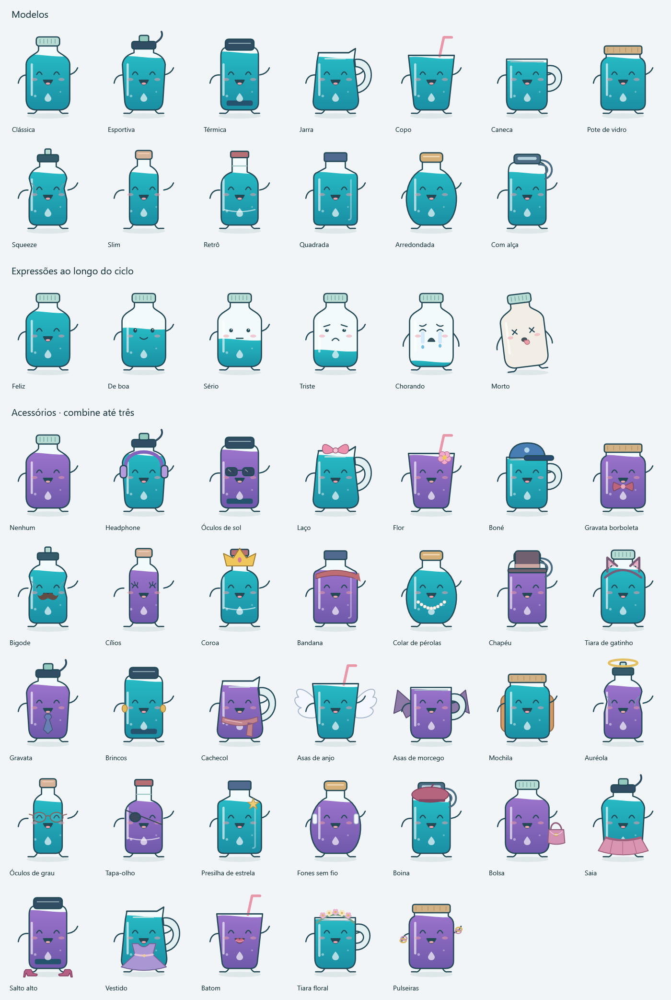

# Gole

Companheiro de desktop para lembrar de beber água. Um personagem flutuante esvazia ao longo do intervalo e volta a ficar cheio quando você registra um gole.

## Baixar para Windows

[**Baixar Gole-Setup.exe — Windows x64**](https://github.com/Obuennoh/gole/releases/latest/download/Gole-Setup.exe)

Instale uma vez. O instalador já inclui o runtime necessário e o download não exige conta.

### Atualizações automáticas

O Gole verifica novas versões ao abrir e a cada seis horas. Os pacotes são baixados em segundo plano e instalados silenciosamente ao encerrar pelo menu **Sair do Gole**. A próxima abertura usa a versão atualizada. Se uma atualização não puder ser aplicada ao sair, a abertura seguinte tenta novamente.

Não é necessário conectar o GitHub, criar token ou configurar uma conta. O botão **Verificar agora**, em **Lembretes → Atualizações automáticas**, permite antecipar a consulta. Sem internet, o pet continua funcionando e tenta atualizar depois.

Suas preferências e registros ficam separados da instalação e permanecem após atualizar. Consulte todas as versões em [Releases](https://github.com/Obuennoh/gole/releases).

Quem usa a versão antiga com a tela **Conectar GitHub** precisa instalar esta versão uma vez para receber o novo atualizador. As próximas atualizações dispensam esse procedimento.

## Funcionalidades

- Pet sobre as outras janelas, com posição e tamanho ajustáveis.
- Intervalo inicial de 30 minutos, configurável entre 5 e 180 minutos.
- Registro em um clique pelo botão **Já bebi um gole**. Configure os ml de cada gole em **Lembretes → Quantidade por gole**; o padrão é 200 ml. Opção de desfazer por 20 segundos.
- Meta diária configurável e histórico do dia no horário local.
- Treze modelos, incluindo garrafinhas squeeze, slim, retrô, quadrada, arredondada e com alça.
- Trinta e dois acessórios para combinar até três itens, incluindo bolsa, saia, salto alto, vestido, batom e tiara floral.
- Seis expressões progressivas: feliz, de boa, sério, triste, chorando e morto ao zerar.
- Editor com rascunho, preview de cada expressão, simulação e salvamento explícito.
- Frases aleatórias a cada cinco minutos, felizes ou irritadas conforme o estado do pet.
- Elogios variados após beber, sem mencionar volume e sem repetição consecutiva.
- Som curto de água em cada fala e lembrete, ativado por padrão e desligável em **Lembretes**; avisos na bandeja sem soneca ou pausa.



## Desenvolvimento local

Requisitos: Windows e [.NET 10 SDK](https://dotnet.microsoft.com/download/dotnet/10.0).

```powershell
git clone https://github.com/Obuennoh/gole.git
cd gole
dotnet restore Gole.sln
dotnet run --project src/Gole.Desktop
```

Para abrir com dados de desenvolvimento separados dos registros pessoais:

```powershell
./scripts/dev.ps1 -Isolated
```

Fechar o painel mantém o pet ativo. Use **Sair** no menu do personagem ou no ícone da bandeja para encerrar o processo.

## Validação

```powershell
./scripts/check.ps1
```

O comando restaura dependências, compila com avisos tratados como erros, executa os testes e verifica a formatação. A mesma rotina roda no GitHub Actions.

Os testes cobrem temporização, falas por estado, três acessórios simultâneos, transições das expressões, desfazer, meia-noite local, recuperação de arquivos e migração dos dados. O teste do editor manipula os controles em uma thread STA **sem mostrar janelas**, sem captura de tela e sem interagir com outros aplicativos.

## Estrutura

```text
src/
  Gole.Core/             Regras de hidratação, sessão e frases
  Gole.Infrastructure/   Persistência JSON e recuperação de backup
  Gole.Desktop/          Interface WPF, desenho vetorial e bandeja
tests/
  Gole.Tests/            Regras e persistência
  Gole.Desktop.Tests/    Comportamento do editor sem janelas visíveis
scripts/                Desenvolvimento e verificações
docs/                   Arquitetura e critérios de validação
```

Consulte as [decisões de arquitetura](docs/architecture.md) e o [escopo de validação](docs/validation.md).

## Dados

Os lembretes e o registro de água funcionam offline. A internet é usada apenas para consultar e baixar atualizações públicas; o histórico de água e as preferências não são enviados. Os dados ficam em `%LOCALAPPDATA%\Gole\preferences.json`, com uma cópia anterior em `.bak`, separados por usuário do Windows em cada máquina. O visual e os lembretes são restaurados ao reabrir, após salvar suas alterações. O modo isolado usa `.local/dev-state` dentro do checkout; essa pasta não é versionada.

Você define a quantidade por gole nas configurações, com padrão de 200 ml. Cada clique em **Já bebi um gole** soma exatamente esse valor ao histórico e à meta diária, enche o pet e reinicia o intervalo. A quantidade pode ser alterada para os próximos registros, preservando os volumes antigos. O pet leva um intervalo para passar de cheio a vazio; a meta diária é independente do nível. As notificações pela bandeja dependem das configurações do Windows.

## Distribuição

Cada push em `main`, após passar nos testes, gera uma release pública versionada com Velopack. O pipeline verifica a instalação e a atualização entre versões em um runner Windows descartável antes de publicar o instalador. O pacote é instalado em `%LOCALAPPDATA%\GoleDesktop`, separado dos dados em `%LOCALAPPDATA%\Gole`.

`scripts/package.ps1 -Version 0.1.1` gera o pacote localmente. `scripts/smoke-install-update.ps1` é exclusivo do CI e não executa no computador de desenvolvimento. Os builds de desenvolvimento não tentam substituir arquivos nem baixar atualizações.
