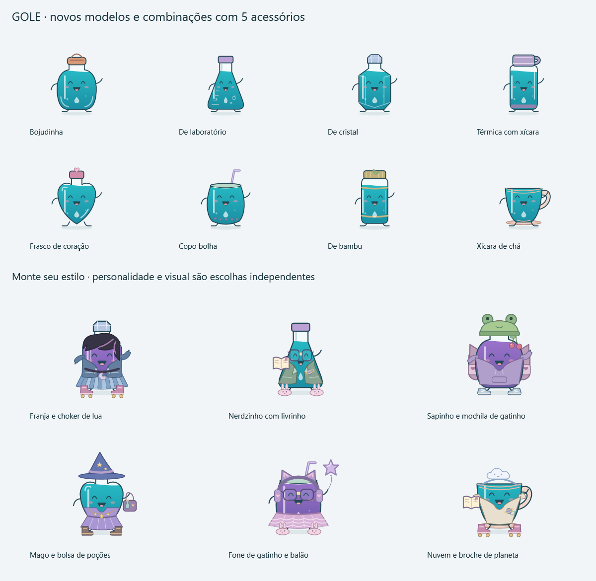
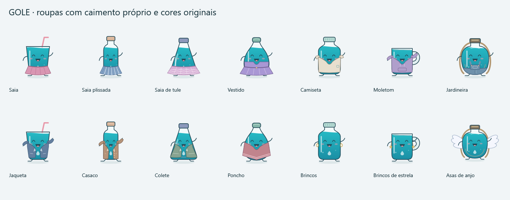

# Gole

Companheiro de desktop para lembrar de beber água. Um personagem flutuante esvazia ao longo do intervalo e volta a ficar cheio quando você registra um gole.

## Baixar para Windows

[**Baixar Gole-Setup.exe — Windows x64**](https://github.com/Obuennoh/gole/releases/latest/download/Gole-Setup.exe)

Instale uma vez. O instalador já inclui o runtime necessário e o download não exige conta.

### Atualizações automáticas

O Gole verifica novas versões ao abrir e a cada seis horas. Os pacotes são baixados em segundo plano e instalados silenciosamente ao encerrar pelo menu **Sair do Gole**. A próxima abertura usa a versão atualizada. Se uma atualização não puder ser aplicada ao sair, a abertura seguinte tenta novamente.

Não é necessário conectar o GitHub, criar token ou configurar uma conta. O botão **Verificar agora**, em **Lembretes → Atualizações automáticas**, permite antecipar a consulta. Sem internet, o pet continua funcionando e tenta atualizar depois.

Suas preferências e registros ficam separados da instalação e permanecem após atualizar. Consulte todas as versões em [Releases](https://github.com/Obuennoh/gole/releases).

Quem usa a versão antiga com a tela **Conectar GitHub** precisa instalar esta versão uma vez para receber o novo atualizador. As próximas atualizações dispensam esse procedimento.

## Funcionalidades

- Pet sobre as outras janelas, com posição livre e tamanho ajustável: arraste até os cantos e bordas da tela, com a posição lembrada ao reabrir. O balão de fala fica separado e não empurra o personagem.
- Personagem animado: respiração, piscadas, gestos quando está bem, cansaço conforme a sede e comemoração ao registrar um gole.
- Asas batendo, orelhas e brincos balançando, capa ao vento, balão flutuando, chama no jetpack, notas decorativas nos fones, reflexos nos óculos e brilhos nas peças. Roupas e acessórios de mão acompanham os gestos.
- Intervalo inicial de 30 minutos, configurável entre 5 e 180 minutos.
- Registro em um clique pelo botão **Já bebi um gole**. Configure os ml de cada gole em **Lembretes → Quantidade por gole**; o padrão é 200 ml. Desfaça o último gole ou qualquer registro do histórico, sem limite de tempo, inclusive após reabrir.
- Meta diária configurável e histórico de todos os dias, com paginação, remoção individual e limpeza completa com confirmação.
- 29 modelos, incluindo bojudinha, laboratório, cristal, térmica com xícara, frasco de coração, copo bolha, bambu e xícara de chá.
- 82 acessórios para combinar até cinco itens: roupas, calçados, bijuterias e fantasia, incluindo capa de herói, jetpack, orelhas de coelho e tiara de unicórnio.
- Roupas com cortes próprios: saias e vestidos com cintura ajustada e barra aberta, camisetas e moletons com mangas, jardineira com alças e bolsos, casacos e coletes abertos e poncho com ponta.
- Até cinco itens compatíveis; vestir outra peça do mesmo tipo substitui a anterior. Roupas e acessórios usam suas cores originais.
- Novas peças: franja emo, óculos com fita, livrinho, fone de gatinho, choker de lua, colar de estrelas, touca de sapinho, chapéu de mago, tiara de nuvem, presilha de cereja, mochila de gatinho, bolsa de poções, patins, pantufas de coelho, broche de planeta e balão de estrela.
- Seis expressões progressivas: feliz, de boa, sério, triste, chorando e morto ao zerar.
- Editor com rascunho, preview de cada expressão, simulação e salvamento explícito.
- Onze personalidades: emo, brava, debochada, carinhosa, motivadora, zen, dramática, nerd, gamer, filosófica e pirata, além do modo **Aleatória**.
- Nerd reescrito como um nerdzinho fofo e tímido; Emo com franja, música e humor melancólico. Todas as demais vozes receberam ajustes nos seis humores e nas reações. A personalidade muda as falas; o visual continua à sua escolha.
- 616 frases próprias, distribuídas pelos seis estados do pet e pelas respostas após beber; sem repetição imediata.
- Escolha em **Personalizar → Personalidade**, veja a prévia e clique em **Salvar personalização**.
- Elogios variados após beber, sem mencionar volume e sem repetição consecutiva.
- Cinco sons para falas e lembretes: água no copo, bolhas, água correndo, gota única e sino suave. Escolha e teste com **Ouvir** em **Lembretes**, ajuste o volume de 0% a 100% ou desligue o áudio; avisos na bandeja sem soneca ou pausa.



### Posição na tela

Arraste o corpo do pet até onde quiser, inclusive junto às bordas e aos cantos. A posição é salva ao soltar e restaurada ao reabrir; o espaço transparente da janela e o balão de fala não limitam o arraste. Coordenadas negativas são permitidas para alcançar as bordas e usar monitores à esquerda ou acima do principal.

O balão abre acima, abaixo ou ao lado, conforme o espaço disponível, sem mudar a posição do personagem. Se um monitor for removido e o pet ficar inacessível, ele é recuperado para um monitor conectado.

### Animações

Em **Personalizar**, marque **Animar personagem e acessórios** e clique em **Salvar personalização**. A opção **Ver reação ao beber** mostra a comemoração na prévia sem registrar água nem alterar o nível real. Desmarcar a animação deixa o corpo, as asas, os brilhos, as gotas e os demais acessórios parados. Preferências anteriores são respeitadas.

A animação usa tempo decorrido e tem limite de 30 quadros por segundo. O personagem permanece no lugar escolhido na tela. Os gestos ficam mais discretos com a sede; o gole dispara uma comemoração curta, com pulinhos e bolhas.

### Roupas e acessórios

Em **Personalizar → Acessórios**, clique para vestir ou tirar uma peça e confira o resultado antes de **Salvar personalização**. Uma segunda peça do mesmo tipo substitui a anterior, incluindo saias, roupas de cima, óculos, chapéus, tiaras e calçados. Peças de tipos diferentes continuam combináveis, até cinco itens.

As roupas e acessórios usam cores próprias, sem controles de pintura ou estampa. A escolha de cor do recipiente continua disponível. Personalizações de acessórios feitas em versões anteriores retornam ao desenho original ao atualizar.



## Desenvolvimento local

Requisitos: Windows e [.NET 10 SDK](https://dotnet.microsoft.com/download/dotnet/10.0).

```powershell
git clone https://github.com/Obuennoh/gole.git
cd gole
dotnet restore Gole.sln
dotnet run --project src/Gole.Desktop
```

Para abrir com dados de desenvolvimento separados dos registros pessoais:

```powershell
./scripts/dev.ps1 -Isolated
```

Fechar o painel mantém o pet ativo. Use **Sair** no menu do personagem ou no ícone da bandeja para encerrar o processo.

## Validação

```powershell
./scripts/check.ps1
```

O comando restaura dependências, compila com avisos tratados como erros, executa os testes e verifica a formatação. A mesma rotina roda no GitHub Actions.

Os testes cobrem temporização, falas por estado, cinco acessórios simultâneos, transições das expressões, desfazer, meia-noite local, recuperação de arquivos e migração dos dados. O teste do editor manipula os controles em uma thread STA **sem mostrar janelas**, sem captura de tela e sem interagir com outros aplicativos.

## Estrutura

```text
src/
  Gole.Core/             Regras de hidratação, sessão e frases
  Gole.Infrastructure/   Persistência JSON e recuperação de backup
  Gole.Desktop/          Interface WPF, desenho vetorial e bandeja
tests/
  Gole.Tests/            Regras e persistência
  Gole.Desktop.Tests/    Comportamento do editor sem janelas visíveis
scripts/                Desenvolvimento e verificações
docs/                   Arquitetura e critérios de validação
```

Consulte as [decisões de arquitetura](docs/architecture.md) e o [escopo de validação](docs/validation.md).

## Dados

Os lembretes e o registro de água funcionam offline. A internet é usada apenas para consultar e baixar atualizações públicas; o histórico de água e as preferências não são enviados. Os dados ficam em `%LOCALAPPDATA%\Gole\preferences.json`, com uma cópia anterior em `.bak`, separados por usuário do Windows em cada máquina. O visual e os lembretes são restaurados ao reabrir, após salvar suas alterações. O modo isolado usa `.local/dev-state` dentro do checkout; essa pasta não é versionada.

Você define a quantidade por gole nas configurações, com padrão de 200 ml. Cada clique em **Já bebi um gole** soma exatamente esse valor ao histórico e à meta diária, enche o pet e reinicia o intervalo. A quantidade pode ser alterada para os próximos registros, preservando os volumes antigos. O pet leva um intervalo para passar de cheio a vazio; a meta diária é independente do nível. As notificações pela bandeja dependem das configurações do Windows.

## Distribuição

Cada push em `main`, após passar nos testes, gera uma release pública versionada com Velopack. O pipeline verifica a instalação e a atualização entre versões em um runner Windows descartável antes de publicar o instalador. O pacote é instalado em `%LOCALAPPDATA%\GoleDesktop`, separado dos dados em `%LOCALAPPDATA%\Gole`.

`scripts/package.ps1 -Version 0.1.1` gera o pacote localmente. `scripts/smoke-install-update.ps1` é exclusivo do CI e não executa no computador de desenvolvimento. Os builds de desenvolvimento não tentam substituir arquivos nem baixar atualizações.

As fontes e licenças dos sons estão em [Créditos de áudio](docs/audio-credits.md).
