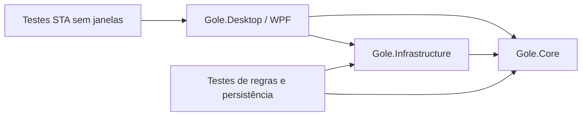

# Arquitetura

## Limites entre projetos

**Core** não referencia WPF, Windows Forms, arquivos ou relógios globais. Os métodos recebem o instante UTC da operação, o que permite testar intervalos e retomadas sem esperar pelo tempo real. `HydrationState` representa o estado persistido; `HydrationSession` coordena registro, desfazer e emissão de lembretes. `ServingMl` define a quantidade de cada gole, inicialmente 200 ml e configurável de 1 a 6.000 ml. O registro não recebe uma quantidade pela interface: usa o valor salvo, soma ao histórico e repõe o pet inteiro. O schema 11 inicializa essa configuração sem alterar os registros antigos, as preferências nem os prazos.

**Infrastructure** implementa `JsonStateStore`. A gravação usa arquivo temporário, flush e substituição atômica. O carregamento tenta o arquivo principal e depois a cópia anterior. Após recuperar um principal corrompido, o primeiro salvamento preserva o backup válido. Falhas de gravação são retornadas à interface; um schema futuro é rejeitado para evitar sobrescrita de dados incompatíveis.

**Desktop** contém a composição da aplicação, a janela flutuante, o painel e o desenho vetorial. O temporizador WPF consulta a sessão; não contém regras de contagem. As operações de apresentação permanecem na thread da interface. O ícone da bandeja e o temporizador são iniciados apenas quando a janela flutuante é carregada e descartados ao encerrar.

## Decisões

### Interface nativa

WPF atende transparência, janela sempre à frente, arraste e integração com a bandeja sem carregar um navegador. Windows Forms é usado somente para a bandeja e informações dos monitores. A interface é construída em C#; a paleta e os templates compartilhados ficam em `Styling/Theme.cs`.

Não há contêiner de injeção de dependências: `App` compõe os serviços e passa as instâncias necessárias. O domínio é independente da apresentação, enquanto os eventos dos controles continuam locais às duas janelas.

### Estado e tempo

- O ciclo inicia cheio e chega a zero em um intervalo.
- Um registro usa o volume configurado, enche o pet e agenda o próximo lembrete após um intervalo completo. Alterar o volume configurado afeta apenas os próximos registros, sem reiniciar o relógio ou modificar os anteriores.
- A pausa exclui o tempo pausado do esvaziamento.
- A retomada conserva o tempo restante; não reinicia um intervalo completo.
- Após suspensão do computador, um tick atrasado emite no máximo um aviso.
- Uma fala no balão ocorre a cada cinco minutos e usa o estado atual do personagem para selecionar a mensagem. O aviso de beber água substitui uma fala simultânea. O prazo da próxima fala é persistido e é reiniciado após registrar água.
- O pet permanece vazio após o prazo até um novo registro.
- Desfazer não tem limite de tempo. O último gole da sessão pode restaurar o snapshot anterior; pausa, mudança de intervalo ou qualquer remoção descartam esse snapshot para evitar restaurar dados antigos. Sem snapshot, remover o registro mais recente recalcula o nível e o prazo a partir do último gole restante. Remover um registro anterior altera apenas os totais. Limpar tudo zera os registros, deixa o pet vazio e agenda o próximo lembrete após um intervalo, preservando as preferências.
- O total diário usa o fuso local. Os instantes persistidos usam ticks UTC, preservando compatibilidade com os registros existentes.

Os controles de pausa e soneca foram removidos. A lógica de pausa continua coberta para compatibilidade de dados; ao abrir uma instalação com pausa antiga pendente, `App` retoma a contagem automaticamente.

### Editor

As alterações visuais ficam em um rascunho. O preview usa o mesmo componente vetorial do pet, com nível independente dos registros reais. **Salvar personalização** aplica o rascunho; **Descartar alterações** recupera o estado salvo. As cores são escolhidas exclusivamente na paleta. A seleção de acessórios permite até três itens distintos; remover um item libera uma vaga. Itens de fundo são desenhados antes do corpo para permitir combinações com acessórios de rosto e cabeça.

`PetCatalog` centraliza os modelos, os acessórios e o limite da seleção. O schema 3 migra o acessório único das versões anteriores para uma lista sem reiniciar o intervalo nem alterar os registros. `HydrationExpression` define as faixas de expressão: feliz acima de 80%, de boa até 60%, sério até 40%, triste até 20%, chorando até esvaziar e morto em zero. Pausa mantém a expressão de sono; um novo registro recupera o personagem.

A navegação usa `ContentControl` para manter os controles ativos na árvore de conteúdo e de acessibilidade, sem um `TabControl` com cabeçalhos ocultos.

### Renderização e recursos

Os recipientes e acessórios são vetores. Geometrias, canetas e pincéis estáticos são congelados e reutilizados. A onda usa uma geometria por quadro; não entra no cache. O desenho é limitado a aproximadamente 15 quadros por segundo, e o painel interrompe sua atualização quando não está visível.

### Dados pessoais e distribuição

Os lembretes funcionam offline. O subsistema de atualização usa HTTPS para consultar exclusivamente as releases públicas de `Obuennoh/gole`. Não há autenticação, telemetria nem envio de preferências ou histórico. A credencial criptografada de versões anteriores, se existir, é removida localmente sem ser lida ou enviada. Não há serviço de sistema instalado pelo aplicativo.

O build de desenvolvimento gera uma assembly executada pelo runtime .NET, com `UseAppHost=false`, e não baixa atualizações. O publish de distribuição usa win-x64 self-contained e Velopack, incluindo o runtime. O pacote instala em `%LOCALAPPDATA%\GoleDesktop`, separado dos dados em `%LOCALAPPDATA%\Gole`.

`DesktopUpdateService` serializa verificações automáticas e manuais, tolera falha de rede e expõe o status à interface. `GithubUpdateBackend` usa `SimpleWebSource` no endereço público fixo `releases/latest/download/`, sem credenciais nem consultas à API do GitHub. O Velopack consulta o índice e verifica os pacotes antes de aplicar. Uma verificação ocorre ao iniciar e a cada seis horas. O pacote fica preparado e é aplicado silenciosamente ao sair, após salvar os dados. `VelopackApp` também tenta aplicar pacotes pendentes na abertura seguinte, antes de inicializar WPF ou adquirir o mutex. Isso preserva edições em andamento sem forçar um reinício.

O job de release depende dos testes. Ele gera uma versão monotônica por execução, cria o instalador, testa uma instalação e uma atualização reais no runner descartável e só depois publica a release. Depois da publicação, verifica o feed público sem credenciais. O arquivo para download mantém o nome `Gole-Setup.exe`; pacotes e índices de atualização são publicados junto dele. Binários continuam fora do histórico Git.

## Pontos que exigem validação adicional

- Múltiplos monitores com escalas de DPI diferentes e mudanças de docking.
- Modo de foco, políticas corporativas e comportamento de notificações do Windows.
- Ciclos longos de suspensão/hibernação em hardware real.
- Empacotamento e execução em uma instalação limpa de Windows.

Esses cenários não são garantidos pelos testes de domínio ou pelos testes de controles sem janela.

### Som das falas

Cinco WAVs PCM curtos são incorporados à assembly. Quatro usam amostras CC0 adaptadas; as fontes e licenças estão em `docs/audio-credits.md`. `SoundCatalog` define os identificadores e nomes disponíveis. `AlertSoundId` persiste a escolha; o preview usa o rascunho do seletor sem alterar a preferência salva. `WaterSound` carrega cada recurso uma vez, reproduz sem bloquear a interface e impede sobreposição em falas consecutivas. Um preview interrompe o som anterior e pode ser repetido imediatamente. `AlertVolume` guarda o nível de 0 a 100, inicialmente 70. `WaveVolume` escala as amostras PCM em memória sem alterar o arquivo original nem o volume geral do Windows. O cache mantém no máximo uma versão de volume por som. Falhas do dispositivo de áudio não interrompem o lembrete. `SpeechSound` começa ativado e a escolha fica persistida; o campo legado `Sound` é preservado apenas por compatibilidade. O script de desenvolvimento `scripts/prepare-audio.py` permite reproduzir o tratamento das amostras licenciadas. Os testes usam uma implementação silenciosa, sem reproduzir áudio no computador de desenvolvimento.

### Histórico

A visão geral lista registros de todos os dias, ordenados do mais recente para o mais antigo, em páginas de oito itens. Cada botão captura a instância exata do registro, distinguindo até dois goles com horário e volume iguais. A lista é reconstruída somente quando os registros ou a página mudam, preservando foco e rolagem durante os ticks do relógio. A limpeza completa pede confirmação com resposta inicial negativa. Os testes exercitam confirmação e cancelamento por uma função injetada, sem abrir diálogos.

### Personalidades e falas

`PersonalityCatalog` carrega uma vez o JSON incorporado `Content/personalities.json`, sem acesso à rede. IDs estáveis identificam nove estilos; o ID zero mantém o modo aleatório. Cada estilo contém oito frases para cada expressão e oito respostas após beber, totalizando 504 mensagens distintas. Não há personalidades regionais.

`ReminderPhrases` e `DrinkReactions` usam o catálogo e excluem a última mensagem da próxima escolha. A fala de abertura, as falas de cinco minutos, as notificações e os elogios após beber respeitam a escolha salva. Mensagens de configuração e de edição do histórico continuam funcionais.

A personalidade integra o rascunho do editor. A prévia usa o humor selecionado, sem mudar registros, tocar áudio ou emitir falas pelo pet real. **Outra frase** oferece um novo exemplo. Salvar aplica e persiste a escolha; descartar recupera o estilo salvo. A mudança de personalidade não reinicia o nível ou os prazos de hidratação. Instalações anteriores recebem o modo aleatório sem perder preferências ou histórico.
