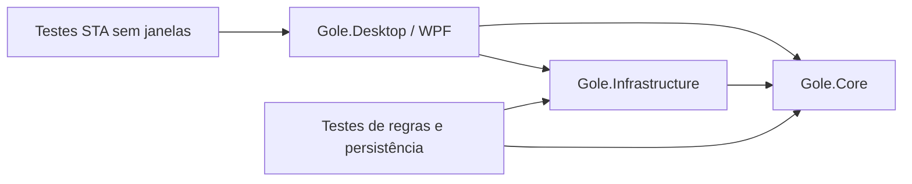

# Arquitetura

## Limites entre projetos

**Core** não referencia WPF, Windows Forms, arquivos ou relógios globais. Os métodos recebem o instante UTC da operação, o que permite testar intervalos e retomadas sem esperar pelo tempo real. `HydrationState` representa o estado persistido; `HydrationSession` coordena registro, desfazer e emissão de lembretes. `ServingMl` define a quantidade de cada gole, inicialmente 200 ml e configurável de 1 a 6.000 ml. O registro não recebe uma quantidade pela interface: usa o valor salvo, soma ao histórico e repõe o pet inteiro. O schema 13 inicializa essa configuração sem alterar os registros antigos, as preferências nem os prazos.

**Infrastructure** implementa `JsonStateStore`. A gravação usa arquivo temporário, flush e substituição atômica. O carregamento tenta o arquivo principal e depois a cópia anterior. Após recuperar um principal corrompido, o primeiro salvamento preserva o backup válido. Falhas de gravação são retornadas à interface; um schema futuro é rejeitado para evitar sobrescrita de dados incompatíveis.

**Desktop** contém a composição da aplicação, a janela flutuante, o painel e o desenho vetorial. O temporizador WPF consulta a sessão; não contém regras de contagem. As operações de apresentação permanecem na thread da interface. O ícone da bandeja e o temporizador são iniciados apenas quando a janela flutuante é carregada e descartados ao encerrar.

## Decisões

### Interface nativa

WPF atende transparência, janela sempre à frente, arraste e integração com a bandeja sem carregar um navegador. Windows Forms é usado somente para a bandeja e informações dos monitores. A interface é construída em C#; a paleta e os templates compartilhados ficam em `Styling/Theme.cs`.

Não há contêiner de injeção de dependências: `App` compõe os serviços e passa as instâncias necessárias. O domínio é independente da apresentação, enquanto os eventos dos controles continuam locais às duas janelas.

### Estado e tempo

- O ciclo inicia cheio e chega a zero em um intervalo.
- Um registro usa o volume configurado, enche o pet e agenda o próximo lembrete após um intervalo completo. Alterar o volume configurado afeta apenas os próximos registros, sem reiniciar o relógio ou modificar os anteriores.
- A pausa exclui o tempo pausado do esvaziamento.
- A retomada conserva o tempo restante; não reinicia um intervalo completo.
- Após suspensão do computador, um tick atrasado emite no máximo um aviso.
- Uma fala no balão ocorre a cada cinco minutos e usa o estado atual do personagem para selecionar a mensagem. O aviso de beber água substitui uma fala simultânea. O prazo da próxima fala é persistido e é reiniciado após registrar água.
- O pet permanece vazio após o prazo até um novo registro.
- Desfazer não tem limite de tempo. O último gole da sessão pode restaurar o snapshot anterior; pausa, mudança de intervalo ou qualquer remoção descartam esse snapshot para evitar restaurar dados antigos. Sem snapshot, remover o registro mais recente recalcula o nível e o prazo a partir do último gole restante. Remover um registro anterior altera apenas os totais. Limpar tudo zera os registros, deixa o pet vazio e agenda o próximo lembrete após um intervalo, preservando as preferências.
- O total diário usa o fuso local. Os instantes persistidos usam ticks UTC, preservando compatibilidade com os registros existentes.

Os controles de pausa e soneca foram removidos. A lógica de pausa continua coberta para compatibilidade de dados; ao abrir uma instalação com pausa antiga pendente, `App` retoma a contagem automaticamente.

### Editor

As alterações visuais ficam em um rascunho. O preview usa o mesmo componente vetorial do pet, com nível independente dos registros reais. **Salvar personalização** aplica o rascunho; **Descartar alterações** recupera o estado salvo. As cores são escolhidas exclusivamente na paleta. A seleção de acessórios permite até cinco itens distintos; remover um item libera uma vaga. Itens de fundo são desenhados antes do corpo para permitir combinações com acessórios de rosto e cabeça.

`PetCatalog` centraliza os modelos, os acessórios e o limite da seleção. O schema 3 migra o acessório único das versões anteriores para uma lista sem reiniciar o intervalo nem alterar os registros. `HydrationExpression` define as faixas de expressão: feliz acima de 80%, de boa até 60%, sério até 40%, triste até 20%, chorando até esvaziar e morto em zero. Pausa mantém a expressão de sono; um novo registro recupera o personagem.

A navegação usa `ContentControl` para manter os controles ativos na árvore de conteúdo e de acessibilidade, sem um `TabControl` com cabeçalhos ocultos.

### Renderização e recursos

Os recipientes e acessórios são vetores. Geometrias, canetas e pincéis estáticos são congelados e reutilizados. A onda usa uma geometria por quadro; não entra no cache. O desenho é limitado a 30 quadros por segundo, e o painel interrompe sua atualização quando não está visível.

### Dados pessoais e distribuição

Os lembretes funcionam offline. O subsistema de atualização usa HTTPS para consultar exclusivamente as releases públicas de `Obuennoh/gole`. Não há autenticação, telemetria nem envio de preferências ou histórico. A credencial criptografada de versões anteriores, se existir, é removida localmente sem ser lida ou enviada. Não há serviço de sistema instalado pelo aplicativo.

O build de desenvolvimento gera uma assembly executada pelo runtime .NET, com `UseAppHost=false`, e não baixa atualizações. O publish de distribuição usa win-x64 self-contained e Velopack, incluindo o runtime. O pacote instala em `%LOCALAPPDATA%\GoleDesktop`, separado dos dados em `%LOCALAPPDATA%\Gole`.

`DesktopUpdateService` serializa verificações automáticas e manuais, tolera falha de rede e expõe o status à interface. `GithubUpdateBackend` usa `SimpleWebSource` no endereço público fixo `releases/latest/download/`, sem credenciais nem consultas à API do GitHub. O Velopack consulta o índice e verifica os pacotes antes de aplicar. PrepareLaunchAsync faz uma verificação antes de criar a aplicação WPF, com cancelamento em 15 segundos. Se houver pacote pronto, agenda aplicação com restart e Main retorna, liberando o mutex antes do relançamento. A rotina de fundo verifica a cada 15 minutos ou um minuto após falha, sem duplicar a checagem inicial. O pacote fica preparado e é aplicado silenciosamente ao sair, após salvar os dados. `VelopackApp` também tenta aplicar pacotes pendentes na abertura seguinte, antes de inicializar WPF ou adquirir o mutex. Isso preserva edições em andamento sem forçar um reinício.

O job de release depende dos testes. Ele gera uma versão monotônica por execução, cria o instalador, testa uma instalação e uma atualização reais no runner descartável e só depois publica a release. Depois da publicação, verifica o feed público sem credenciais. O arquivo para download mantém o nome `Gole-Setup.exe`; pacotes e índices de atualização são publicados junto dele. Binários continuam fora do histórico Git.

## Pontos que exigem validação adicional

- Múltiplos monitores com escalas de DPI diferentes e mudanças de docking.
- Modo de foco, políticas corporativas e comportamento de notificações do Windows.
- Ciclos longos de suspensão/hibernação em hardware real.
- Empacotamento e execução em uma instalação limpa de Windows.

Esses cenários não são garantidos pelos testes de domínio ou pelos testes de controles sem janela.

### Som das falas

Cinco WAVs PCM curtos são incorporados à assembly. Quatro usam amostras CC0 adaptadas; as fontes e licenças estão em `docs/audio-credits.md`. `SoundCatalog` define os identificadores e nomes disponíveis. `AlertSoundId` persiste a escolha; o preview usa o rascunho do seletor sem alterar a preferência salva. `WaterSound` carrega cada recurso uma vez, reproduz sem bloquear a interface e impede sobreposição em falas consecutivas. Um preview interrompe o som anterior e pode ser repetido imediatamente. `AlertVolume` guarda o nível de 0 a 100, inicialmente 70. `WaveVolume` escala as amostras PCM em memória sem alterar o arquivo original nem o volume geral do Windows. O cache mantém no máximo uma versão de volume por som. Falhas do dispositivo de áudio não interrompem o lembrete. `SpeechSound` começa ativado e a escolha fica persistida; o campo legado `Sound` é preservado apenas por compatibilidade. O script de desenvolvimento `scripts/prepare-audio.py` permite reproduzir o tratamento das amostras licenciadas. Os testes usam uma implementação silenciosa, sem reproduzir áudio no computador de desenvolvimento.

### Histórico

A visão geral lista registros de todos os dias, ordenados do mais recente para o mais antigo, em páginas de oito itens. Cada botão captura a instância exata do registro, distinguindo até dois goles com horário e volume iguais. A lista é reconstruída somente quando os registros ou a página mudam, preservando foco e rolagem durante os ticks do relógio. A limpeza completa pede confirmação com resposta inicial negativa. Os testes exercitam confirmação e cancelamento por uma função injetada, sem abrir diálogos.

### Personalidades e falas

`PersonalityCatalog` carrega uma vez o JSON incorporado `Content/personalities.json`, sem acesso à rede. IDs estáveis identificam quinze estilos; o ID zero mantém o modo aleatório. Cada estilo contém dez frases para cada expressão e dez respostas após beber, totalizando 1.050 mensagens distintas. Emo usa o ID 11 e Brava usa o ID 10 e participa também do modo aleatório, sem alterar as escolhas anteriores. Não há personalidades regionais.

`ReminderPhrases` e `DrinkReactions` usam o catálogo e excluem a última mensagem da próxima escolha. A fala de abertura, as falas de cinco minutos, as notificações e os elogios após beber respeitam a escolha salva. Mensagens de configuração e de edição do histórico continuam funcionais.

A personalidade integra o rascunho do editor. A prévia usa o humor selecionado, sem mudar registros, tocar áudio ou emitir falas pelo pet real. **Outra frase** oferece um novo exemplo. Salvar aplica e persiste a escolha; descartar recupera o estilo salvo. A mudança de personalidade não reinicia o nível ou os prazos de hidratação. Instalações anteriores recebem o modo aleatório sem perder preferências ou histórico.

### Catálogo visual

O catálogo mantém IDs anteriores e acrescenta oito silhuetas de garrafinha e dezoito acessórios. `Bottle.ExtendedStyles.cs` concentra os novos detalhes e usa as mesmas geometrias, pincéis e canetas compartilhadas. Capa de herói e jetpack são desenhados antes do corpo; os demais itens são desenhados à frente. Todos os modelos usam o mesmo nível de água e as seis expressões. As combinações continuam limitadas a cinco itens distintos.

### Roupas e acessórios

`Bottle.Fitting.cs` mede o contorno de cada modelo e fornece pontos de encaixe. `Bottle.Clothing.cs` define cortes próprios para as 11 roupas. A cintura das saias acompanha o recipiente, e a barra se abre para fora dele; o vestido combina um corpete com a saia. Camiseta, moletom, jaqueta, casaco e colete usam geometrias de tecido com folga, mangas e detalhes próprios. Jardineira e poncho têm desenhos específicos. O contorno do copo é uma referência de medida, não uma máscara universal para a roupa.

Brincos são desenhados individualmente, sem escala horizontal, com âncora na borda do recipiente; sua rotação usa a mesma âncora. Mangas, braços e acessórios de mão compartilham as transformações da animação. Camadas têm ordem estável por categoria e ID.

`PetCatalog` define as categorias exclusivas de chapéu, óculos, parte inferior, parte superior, calçado e tiara. Escolher uma peça substitui outra da mesma categoria, inclusive quando as cinco vagas estão ocupadas. A normalização aplica a mesma regra a preferências anteriores. Acessórios de categorias distintas continuam combináveis.

O schema 15 remove os estilos customizados dos acessórios ao carregar. `AccessoryStyle` e o campo legado `AccessoryStyles` existem apenas para ler preferências das versões 0.2.14–0.2.15; não são usados pelo desenho nem pelo editor. Cores e estampas de acessórios voltam ao original, preservando cor do recipiente, itens vestidos, registros, posições e prazos. O renderizador de pintura foi removido.

Desenhos são congelados em cache limitado por modelo, peça, parte, pose e combinação. O catálogo mantém todos os 82 IDs e o limite de cinco itens compatíveis.

### Animação do personagem

`CharacterMotion` calcula uma pose determinística a partir do tempo decorrido, nível, preferência de movimento e idade da comemoração. Não usa relógio global nem altera registros. Respiração e inclinação afetam a cena inteira, mantendo roupas e corpo juntos. Os braços usam as mesmas transformações das mangas, pulseiras, relógio, bolsa, varinha e balão. Asas, orelhas, brincos e chama usam partes vetoriais estáticas separadas, congeladas no cache; o tempo não integra a chave do cache.

`Bottle.Animation.cs` compõe as transformações e os efeitos. Máscaras de opacidade baseadas no desenho original recortam os reflexos à superfície da peça. Um enquadramento calculado pela aparência reserva o envelope dos movimentos, evitando zoom a cada quadro. As alças são desenhadas antes das asas e dos demais acessórios de fundo. O jetpack usa a largura inferior do recipiente e uma placa de conexão entre os propulsores.

As janelas usam `Stopwatch` para o tempo da animação, com atualização de no máximo 30 quadros por segundo e sem desenhar janelas ocultas. O gole reinicia a comemoração de 2,4 segundos, sem persistir estado transitório. O painel tem um relógio de prévia separado: **Ver reação ao beber** não chama o registro de água, não toca som e não altera a sessão real. `Motion` já existente controla tanto o corpo como todos os efeitos dos acessórios; seu valor salvo é preservado. Miniaturas do guarda-roupa permanecem paradas.

### Posicionamento livre

A janela do personagem contém apenas `Bottle`, com largura e altura iguais ao viewport do desenho. A fala usa um `Popup` independente com quatro posições candidatas e não participa da medição do pet. Mudanças na localização ou no tamanho reposicionam o balão; ocultar ou encerrar o pet fecha a fala. Testes de controles mantêm o popup fechado ao trabalhar com janelas não mostradas.

`Bottle.DragBounds` mapeia uma região central do corpo para coordenadas locais do viewport. `KeepVisible` converte essa região com `PointToScreen` e compara com `Screen.Bounds` em pixels. `DesktopPlacement.RecoveryOffset` preserva a posição sempre que uma pequena área do corpo continua alcançável em algum monitor. O tamanho total da janela, a área de trabalho e o balão não são usados como limites de arraste. Apenas posições inacessíveis são recuperadas ao soltar, reabrir ou mudar a disposição dos monitores. O deslocamento de recuperação é convertido de volta para DIPs.

O schema 16 converte uma vez as posições salvas pela janela antiga de 276 DIPs de largura e reserva superior de 68 DIPs para a origem do viewport. Valores padrão permanecem padrão; coordenadas negativas continuam válidas e persistidas. A validação automatizada cobre cantos, bordas, área da barra de tarefas, monitores com origem negativa, lacunas, desconexão, coordenadas em pixels escalados, migração e falas que não deslocam o personagem.

### Coleção ampliada

Os IDs 21–28 acrescentam oito recipientes e os IDs 67–82 acrescentam dezesseis acessórios, desenhados em `Bottle.Collection.cs`. As peças usam os mesmos pontos de encaixe e gestos das anteriores. O limite é de cinco peças; fones, colares, brincos, broches, presilhas, mochilas e objetos da mesma mão também substituem seus equivalentes. A personalidade controla as falas sem alterar o visual escolhido. O formato de preferências permanece na versão 16.

### Looks e interações

Preferências versão 17 acrescentam `Looks`, com normalização de até 30 snapshots independentes de cor, modelo e acessórios. Versões anteriores começam com lista vazia. `Wardrobe` concentra categorias, busca sem acentos e sugestões curadas. O editor mantém sugestões no rascunho, mas guardar, renomear, excluir e usar um look são ações explícitas de persistência. `Bottle.Interactions.cs` compõe os gestos sobre a pose base e usa o relógio de animação para encerrar reações em 2,5 segundos. Nenhuma interação chama o registro de água. O arraste altera a posição apenas por movimento do usuário.

### Galeria e tema

Versão 18 acrescenta NightMode, preservando Looks da versão 17. Cartões renderizam snapshots com Bottle sem animação. Criar e editar usam o rascunho, salvar persiste o conjunto, vestir altera apenas aparência. A prévia mede 280×325 DIPs e o palco 380 DIPs. Theme.Night altera somente superfícies e texto da interface, excluindo Bottle e a paleta. Interações têm cooldown de cinco segundos para fala; 44 frases são locais e independentes dos registros.

Referência de aplicação e reinício: [Velopack](https://docs.velopack.io/integrating/overview). A reaplicação automática na inicialização é habilitada explicitamente; desenvolvimento e smoke tests não passam pelo bootstrap de rede.

### Falas, maquiagem e reações

O ID 6 mantém o Nerd fofo e o ID 12 acrescenta Nerd técnico. Nenhum dos dois desenha um livro como gesto: o item 69 continua optativo. IDs 91–99 acrescentam maquiagem e acessórios; o slot 14 torna batons mutuamente exclusivos. Esfumado e blush são desenhados antes dos olhos. As peças novas usam as transformações de rosto e corpo existentes, sem mudar o schema de preferências.

`SpeakGesture` usa a duração do balão (até 12 segundos), entrada e saída suaves e variação de braços por personalidade. Falas carinhosas recebem expressão suave. Cliques, carinho, arrasto e comemorações têm prioridade. O estado é transitório e o relógio de animação controla o término. O movimento espontâneo alterna três variações por ciclo; `TrackDrag` usa deslocamento horizontal e vertical com amortecimento quando o cursor para. `EndDrag` inicia o pouso. As antigas ações explícitas sobre acessórios foram removidas do editor, do menu e do renderizador.

### Mistura de vozes e emoji em cores

Preferências versão 19 acrescentam `PersonalityIds`. O ID principal legado é preservado, fica em primeiro lugar e participa do limite total de três IDs válidos distintos. ID principal zero limpa a mistura e usa todas as vozes. `PersonalityMix` escolhe apenas entre as vozes selecionadas e evita repetir o último estilo quando há mais de uma opção. A seleção é salva separadamente dos looks e participa do rascunho do editor.

As falas de lembrete, gole e toque usam o mesmo seletor por pet; `activePersonality` preserva o estilo sorteado durante o gesto. IDs 13–15 são Dorameiro, Detetive e Caótico. O Dorameiro desenha mãos à frente do corpo durante falas e gestos tímidos, preservando a pose habitual quando há um objeto ocupado na mão.

`EmojiTextBlock` segmenta Unicode por grafemas e intercala texto e imagens Twemoji em `InlineUIContainer`. As 74 imagens PNG são recursos incorporados e congelados em cache. O texto Unicode original continua disponível no componente e na descrição de acessibilidade. Nenhuma imagem é buscada em rede em execução. A licença e os créditos acompanham o pacote na pasta Emoji.
